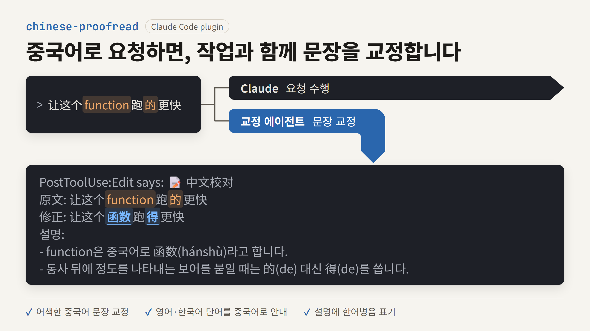

# chinese-proofread

Claude Code에 중국어로 요청을 입력하면, 작업과 동시에 별도의 교정 에이전트가 그 중국어 문장이 자연스러운지 점검하여 결과를 화면에 보여 주는 플러그인입니다. 작업은 Claude가 평소처럼 진행합니다.

Claude Code로 개발하면서 중국어를 배우는 한국어 사용자를 대상으로 만들었으므로, 교정 설명과 그 뒤에 이어지는 답변은 기본적으로 한국어로 출력합니다. 설명에 사용할 언어와 답변에 사용할 언어는 [설정](#설정)에서 각각 바꿀 수 있습니다.

판별과 교정을 어떻게 설계하고 평가했는지는 [설계와 평가](#설계와-평가)에 정리했습니다.



## 시작하기

### 필요한 것

- `python3`: 훅 스크립트를 실행합니다. Python 3.9와 3.14에서 테스트합니다. 없으면 교정이 동작하지 않고, 입력할 때와 답변이 끝날 때 `python3: not found` 훅 오류가 표시됩니다. 요청한 작업은 그대로 진행됩니다.
- 로그인된 `claude` 명령: 교정은 훅이 실행하는 `claude -p`로 진행합니다. 교정을 실행하지 못하면 작업은 그대로 진행하고, `⚠️ 中文校对: proofreading failed (...)` 줄로 실패 이유를 알려 줍니다.

중국어로 판별된 입력마다 작업과 별도로 Sonnet 호출이 한 번 듭니다. 평가에서 1회당 평균 약 $0.005였고, 프롬프트 캐시가 없으면 약 $0.012까지 듭니다.

### 설치

Claude Code에서 다음 두 명령을 한 줄씩 실행합니다. 두 줄을 한 번에 붙여 넣으면 제대로 실행되지 않습니다.

```
/plugin marketplace add robinyoon-dev/chinese-proofread
```

```
/plugin install chinese-proofread@chinese-proofread
```

### 업데이트와 삭제

새 버전으로 업데이트하려면 터미널에서 다음 명령을 실행합니다. 바뀐 내용은 Claude Code를 다시 시작해야 적용됩니다.

```
claude plugin marketplace update chinese-proofread
claude plugin update chinese-proofread@chinese-proofread
```

플러그인을 삭제하려면 터미널에서 다음 명령을 실행합니다. 잠시 끄는 용도라면 [켜고 끄기](#켜고-끄기)의 명령이 더 편리합니다.

```
claude plugin uninstall chinese-proofread@chinese-proofread
claude plugin marketplace remove chinese-proofread
```

## 교정 결과 예시

위 이미지에 나온 요청을 입력하면 다음과 같이 출력됩니다.

```
📝 中文校对
原文: 让这个function跑的更快
修正: 让这个函数跑得更快
설명:
- function은 중국어로 函数(hánshù)라고 합니다.
- 동사 뒤에 정도를 나타내는 보어를 붙일 때는 的(de) 대신 得(de)를 씁니다.
---
```

화면에서는 블록 앞에 `Stop says:`나 `PostToolUse:Bash says:` 같은 문구가 붙습니다. 어느 훅이 표시했는지를 나타내는 Claude Code의 문구입니다.

설명에서 언급하는 중국어 단어에는 성조 부호로 표기한 한어병음을 덧붙입니다. `原文`과 `修正` 줄에는 두 문장을 쉽게 비교할 수 있도록 병음을 붙이지 않습니다.

한국어나 영어 문장에 중국어 단어를 섞어 쓰면, 문장 전체를 다시 쓰지 않고 고친 단어만 알려 줍니다. 고칠 단어가 없으면 `✅` 줄 한 줄만 출력합니다.

```
📝 中文校对
- 例外 → 异常(yìcháng): 프로그래밍에서 말하는 예외는 중국어로 异常이라고 합니다. 例外(lìwài)는 규칙에서 벗어난 경우를 뜻합니다.
---
```

교정 결과는 교정이 끝나는 대로 표시됩니다. 표시할 수 있는 시점은 도구 호출이 끝날 때와 답변이 끝날 때이므로, 짧은 요청에서는 답변 뒤에, 긴 작업에서는 작업 도중에 나옵니다. 교정은 보통 몇 초 안에 끝납니다.

Claude는 교정과 별도로 사용자가 쓴 원문을 기준으로 작업합니다. Claude는 교정 결과를 보지 못하므로, 교정 내용에 대해 Claude에게 물어도 답할 수 없습니다.

## 무엇을 교정하나요

사용자가 직접 쓴 중국어 문장과, 한국어나 영어 문장에 섞어 쓴 중국어 단어를 교정합니다. 따옴표나 백틱으로 감싼 중국어, 번역해 달라고 한 중국어, 붙여 넣은 로그와 파일 안의 중국어는 교정하지 않습니다.

중국어로 어떻게 말하는지 모르는 단어는 위 예시의 `function`처럼 영어나 한국어로 대신 써도 됩니다. 교정 결과에서 그 단어를 중국어로 어떻게 말하는지 알려 줍니다.

이 플러그인의 목적은 중국어 학습이므로, `fix`, `commit`, `edge case`처럼 중국어권 개발자가 영어로도 흔히 쓰는 단어라도 중국어 표현이 있다면 중국어로 바꾸어 알려 줍니다. 다만 다음 단어는 바꾸지 않습니다.

- 코드, 명령어, 파일 경로, 식별자, 약어(`API`, `JSON`, `PR`), 제품이나 서비스의 이름, 브랜치 이름처럼 원래 영어로 쓰는 부분
- `bug`처럼 중국어 문장에서도 영어로 굳어진 단어

중국어를 공부하는 사용자가 한국어 문장에 한자를 썼다면 중국어를 시도했을 가능성이 높으므로, 한국어 한자어처럼 보이는 단어도 중국어로 보고 교정합니다. 예를 들어 `中國語`를 쓰면 중국어로는 `中文`이라고 한다고 알려 줍니다. 중국어를 공부하지 않으면서 한국어 문장에 한자어를 자주 쓴다면, [설정](#설정)의 `CHINESE_PROOFREAD_HANZI_RATIO`를 `0.5`로 설정하여 한자가 적은 한국어 문장을 교정 대상에서 뺄 수 있습니다.

## 켜고 끄기

중국어 학습과 관계없이 중국어 자료를 다루는 동안에는 교정 기능을 잠시 끌 수 있습니다. 설치 직후에는 기능이 켜져 있습니다.

```
/chinese-proofread:toggle off      교정 기능을 끕니다.
/chinese-proofread:toggle on       교정 기능을 다시 켭니다.
/chinese-proofread:toggle status   현재 상태를 확인합니다.
/chinese-proofread:toggle          현재 상태를 반대로 바꿉니다.
```

- 변경한 상태는 다음 입력부터 바로 반영되며, Claude Code를 다시 시작할 필요가 없습니다.
- 상태는 `~/.claude/chinese-proofread/state.json`에 저장되므로, 모든 프로젝트와 세션에 함께 적용되고 Claude Code를 다시 시작해도 유지됩니다.
- 이 명령은 사용자가 직접 입력할 때만 실행됩니다. Claude가 스스로 판단하여 기능을 끄거나 켜지는 않습니다.

## 설정

환경 변수로 동작을 조정할 수 있습니다.

| 환경 변수 | 기본값 | 설명 |
|---|---|---|
| `CHINESE_PROOFREAD_ENABLED` | (없음) | `0`으로 설정하면 교정 기능을 끕니다. 사용 방법은 [특정 프로젝트에서 항상 끄기](#특정-프로젝트에서-항상-끄기)에서 설명합니다. |
| `CHINESE_PROOFREAD_LANG` | `Korean` | 교정 블록의 설명과 `✅` 줄에 사용할 언어입니다. |
| `CHINESE_PROOFREAD_CHAT_LANG` | (없음) | 교정 블록 밖에서 Claude가 사용자에게 하는 말에 사용할 언어입니다. 지정하지 않으면 `CHINESE_PROOFREAD_LANG`과 같은 언어를 쓰고, `prompt`로 설정하면 요청을 쓴 언어를 씁니다. 자세한 동작은 [답변 언어](#답변-언어)에서 설명합니다. |
| `CHINESE_PROOFREAD_MIN_HANZI` | `4` | 중국어로 판별하는 데 필요한 최소 한자 수입니다. |
| `CHINESE_PROOFREAD_MIN_HANZI_MIXED` | `1` | 영문자나 한글이 섞인 입력에 적용하는 최소 한자 수입니다. `CHINESE_PROOFREAD_MIN_HANZI`보다 크게 설정하면 `CHINESE_PROOFREAD_MIN_HANZI` 값을 씁니다. |
| `CHINESE_PROOFREAD_HANZI_RATIO` | `0` | 한자와 한글을 합한 글자 수에서 한자가 차지해야 하는 최소 비율입니다. `0.5`로 설정하면 한자가 적은 한국어 문장을 교정 대상에서 뺍니다. |

`MIN_HANZI`, `MIN_HANZI_MIXED`, `HANZI_RATIO`가 판별에 어떻게 쓰이는지는 [중국어 판별 기준](#중국어-판별-기준)에서 설명합니다.

숫자를 받는 설정에 숫자가 아닌 값을 넣으면 그 설정은 기본값으로 동작합니다.

예를 들어 설명을 영어로 받으려면 `~/.claude/settings.json`에 다음 내용을 추가합니다.

```json
{
  "env": {
    "CHINESE_PROOFREAD_LANG": "English"
  }
}
```

### 답변 언어

Claude가 쓰는 텍스트는 교정 블록, 대화 응답, 작업 결과물의 세 가지로 나뉘며, 각각 다른 기준으로 언어를 정합니다.

| 구분 | 포함하는 내용 | 언어를 정하는 기준 |
|---|---|---|
| 교정 블록 | 교정한 이유의 설명, 단어 교정 줄, `✅` 줄 | `CHINESE_PROOFREAD_LANG` |
| 대화 응답 | 교정 블록 밖에서 사용자에게 하는 말 (작업 중의 진행 상황, 되묻는 질문, 결과 요약) | `CHINESE_PROOFREAD_CHAT_LANG` |
| 작업 결과물 | 코드, 코드 주석, 커밋 메시지, 작성을 요청한 파일의 내용 | 요청 내용과 저장소의 관례 |

- 기본값에서는 중국어로 요청해도 대화 응답을 한국어로 씁니다. 작업 결과에는 무엇을 지웠는지, 테스트를 실행했는지처럼 잘못 읽으면 곤란한 내용이 들어가므로, 중국어로 답변을 받으려면 직접 설정하도록 했습니다.
- Claude가 그래도 최종 답변을 중국어로 쓰면, 플러그인이 지정한 언어로 한 번 다시 쓰게 합니다. 처음 쓴 중국어 답변은 화면에 남고, 그 아래에 `Stop hook error:`로 시작하는 영어 안내문과 다시 쓴 답변이 이어서 나옵니다. `error`는 Claude Code가 붙이는 문구이며 실제 오류가 아닙니다.
- 요청에 `中文`이나 `汉语`가 있으면 Claude가 중국어로 답해도 다시 쓰지 않습니다.
- 프롬프트에서 답변 언어를 직접 지정하면 설정보다 그 지정을 따릅니다.
- 인용하거나 붙여 넣은 중국어만 있는 요청에서는 Claude가 사용자가 직접 쓴 말의 언어로 답합니다. 영어 문장에 중국어 단어를 섞은 요청도 영어로 답할 수 있습니다.
- 작업 결과물에는 이 설정을 적용하지 않습니다. 예를 들어 `用中文写注释`라고 요청하면, 대화 응답이 한국어여도 주석은 중국어로 씁니다.

중국어로 요청했을 때 중국어로 답변을 받으려면 `~/.claude/settings.json`에 다음 내용을 추가합니다.

```json
{
  "env": {
    "CHINESE_PROOFREAD_CHAT_LANG": "prompt"
  }
}
```

### 특정 프로젝트에서 항상 끄기

중국어 문서를 다루는 저장소처럼 특정 프로젝트에서는 교정 기능을 항상 끄고 싶다면, 그 프로젝트의 `.claude/settings.json`에 다음 내용을 추가합니다.

```json
{
  "env": {
    "CHINESE_PROOFREAD_ENABLED": "0"
  }
}
```

- 이 환경 변수를 설정하면 `/chinese-proofread:toggle on`으로 켜 둔 상태와 관계없이 기능이 꺼집니다. `status`를 실행하면 환경 변수 때문에 꺼져 있다는 사실도 함께 알려 줍니다.
- 환경 변수를 추가하거나 바꾼 뒤에는 Claude Code를 다시 시작해야 반영됩니다.
- 모든 프로젝트에서 항상 끄려면 같은 내용을 `~/.claude/settings.json`에 추가합니다. 다만 잠시 끄는 용도라면 환경 변수보다 `/chinese-proofread:toggle off`가 더 편리합니다.

## 한계

### 판별과 교정의 정확도

- 한글 없이 한자만으로 쓴 일본어 문장은 중국어로 판별될 수 있습니다.
- 교정 에이전트는 프롬프트만 보므로, 이전 대화나 `@파일`의 내용을 알지 못합니다.
- 설명에 덧붙이는 한어병음은 모델이 생성하므로, 다음자(多音字)나 성조 변화가 있는 단어에서는 성조가 틀릴 수 있습니다.
- 교정 설명의 내용은 평가로 검증하지 않았으므로, 틀린 설명이 나올 수 있습니다. 정규식 채점자는 형식만 확인합니다.
- 직접 쓴 중국어인지 인용한 중국어인지는 교정 에이전트가 판단하며, 판단이 틀리면 인용한 중국어를 교정하거나 직접 쓴 단어를 놓칠 수 있습니다.
- 한국어 한자어를 중국어 단어로 보고 교정하므로, 중국어를 공부하지 않는 사용자에게는 필요 없는 교정이 나올 수 있습니다. [설정](#설정)의 `CHINESE_PROOFREAD_HANZI_RATIO`로 줄일 수 있습니다.

### 표시 시점

- 교정 결과가 작업 전에 나온다고 보장하지 못합니다. 긴 명령이 도는 동안에는 표시되지 않고, 답변이 끝난 뒤 20초 안에 교정이 끝나지 않으면 다음 턴에 표시됩니다.
- 교정 결과는 대화형 세션의 화면에 표시합니다. `claude -p`의 최종 답변에는 나오지 않습니다.

### 비용

- 한자가 한 글자라도 있는 한국어나 영어 요청에는 훅이 반응하므로, 교정할 대상이 없어도 [Sonnet 호출이 한 번 듭니다](#필요한-것).

### 언어

- `CHINESE_PROOFREAD_LANG`을 한국어나 영어가 아닌 언어로 설정하면 설명에 한국어가 남을 수 있습니다. 교정 규칙이 한국어로 되어 있어 모델이 그 문장을 따라 쓰는 것으로 보입니다. `function`처럼 영어 단어를 섞은 문장에서 일본어는 10회 모두, 프랑스어는 6회 중 4회 한글이 남았습니다.
- 대화 응답의 언어는 Claude가 지시를 따르는 데 의존하며, 플러그인은 최종 답변이 대부분 중국어일 때만 한 번 다시 쓰게 합니다. 따라서 Claude가 중국어로 먼저 답한 내용은 화면에 남고, 다시 쓰는 동안 답변 1회분의 사용량이 더 듭니다. 작업 중의 진행 상황은 다시 쓰지 않습니다.
- `中文`이나 `汉语`를 쓰지 않고 중국어 문구를 써 달라고 요청하면(예: `帮我写一句生日祝福的话`), 답변이 지정한 언어로 다시 쓰입니다. 처음 쓴 중국어 문구는 화면에 남습니다.

## 설계와 평가

이 플러그인은 결과가 항상 같아야 하는 판별은 코드로 처리하고, 문맥을 이해해야 하는 교정은 별도의 모델에 맡깁니다. 판별, 교정, 작업은 서로 다른 방법으로 평가했습니다.

### 주요 설계 결정

- **판별은 훅의 코드로, 교정은 별도 프로세스의 모델로 처리합니다.** 판별은 입력마다 실행되므로 토큰을 쓰지 않고 결과가 항상 같아야 합니다. (설계 결정 1번, 19번)
- **훅은 넓게 감지하고, 교정 에이전트가 교정할 대상을 걸러 냅니다.** 붙여 넣은 로그와 사용자가 직접 쓴 문장을 구분하려면 문맥을 이해해야 하므로, 이 판단은 모델에 맡겼습니다. (설계 결정 4번)
- **판별 설정값은 전체 오탐률 대신 범주별 조건으로 골랐습니다.** "오탐률 10% 이하"라는 처음 기준으로 고른 설정은 `跑local server.`처럼 영어 단어를 섞은 중국어 문장을 놓쳤습니다. 오탐과 미탐의 비용이 범주마다 다르다고 보고 기준을 바꾸었으며, 처음 기준과 바꾼 이유를 함께 기록했습니다. (설계 결정 12번)
- **교정과 작업을 동시에 시작하고, 교정은 끝나는 대로 표시합니다.** 처음에는 교정 블록 없는 도구 호출을 `PreToolUse` 훅이 거부했지만, 이 방식은 대화형 세션에서 동작하지 않았습니다. 훅이 도는 동안 현재 응답이 transcript에 기록되지 않기 때문입니다. 교정을 메인 모델 밖으로 옮기자 모델이 교정을 건너뛰는 문제가 구조적으로 사라졌습니다. 대신 작업 전에 보여 준다는 보장을 포기했습니다. (설계 결정 17번, 19번)

### 평가 결과 요약

- **중국어 판별**: 문장 122개를 조정용 85개와 확인용 37개로 나누어 평가했습니다. 지금의 기본값은 확인용 세트에서 재현율 1.000(27/27), 오탐률 0.500(5/10)입니다. 섞어 쓴 중국어 단어까지 정답으로 계산한 값이며, 판별하기 어려운 문장을 데이터셋에 일부러 많이 넣었으므로 오탐률이 높게 나옵니다. 훅이 한자가 있는 입력에 거의 모두 반응하고 교정 에이전트가 대상을 걸러 내는 구조이므로, 재현율 1.000은 판별이 정밀하다는 뜻이 아닙니다. 오탐 5개는 모두 인용하거나 붙여 넣은 중국어입니다. 이 확인용 세트는 처음 설정값을 정할 때 이미 사용했으므로, 지금 수치는 독립된 검증이 아닙니다. 처음 기본값의 같은 기준 수치는 재현율 0.889(24/27), 오탐률 0.300(3/10)이었고, 섞어 쓴 단어도 교정하기로 하면서 `HANZI_RATIO`를 0.5에서 0으로 낮추었습니다. (설계 결정 14번)
- **교정 품질**: 케이스 40개를 3회씩 실행하고 정규식 채점자로 채점했습니다. 교정 프로세스(Sonnet)의 오류 검출은 45/45, 형식 준수는 349/351, 과잉 교정 없음은 144/144였습니다. Haiku는 오류 검출이 37/45여서 쓰지 않았습니다.
- **작업**: 같은 케이스에서 메인 모델의 작업 수행은 Sonnet과 Opus 모두 117/117이었고, 메인 모델이 교정 블록을 쓰거나 교정을 언급한 경우는 없었습니다. 대화 응답 언어는 Sonnet 114/117, Opus 115/117입니다.
- **대화형 세션**: 시나리오 17개를 3회씩 실행한 51회에서 교정 블록의 수와 표시 시점이 모두 기대와 일치했습니다. 인터럽트와 권한 거부 뒤에도 교정 결과를 잃지 않았습니다. 평가에서 통과한 답변 언어는 대화형 세션에서 어긋난 적이 있으므로, 답변 언어는 대화형으로 따로 측정했습니다. 설명을 요청하는 프롬프트 4개를 한국어와 영어 설정에서 5회씩 실행했을 때, 다시 쓰기 전의 최종 답변은 37/40이고 다시 쓴 뒤에는 40/40입니다.
- 정규식 채점자로는 교정 설명의 내용이 맞는지 확인할 수 없으므로, 이 부분은 검증하지 않았습니다.

### 기록 문서

평가 방법과 전체 수치, 결정마다 검토한 대안은 `docs/` 폴더에 기록했습니다. 처음 읽는다면 다음 두 문서부터 보는 것을 권장합니다.

- [설계 결정 기록](docs/design-decisions.md): 판별을 훅에서 코드로 처리한 이유, 판별 설정값을 고른 기준, 교정과 작업을 함께 진행하는 방법처럼 설계할 때 내린 결정을 기록했습니다. 결정마다 검토한 대안과 감수한 트레이드오프를 함께 적었습니다.
- [평가 결과](docs/eval-results.md): 중국어 판별 정확도와 교정 품질을 평가한 결과를 기록했습니다. 평가마다 날짜, 대상 커밋, 모델, 수치를 적어서, 교정 규칙을 고치기 전과 후의 결과를 비교할 수 있게 했습니다.

`docs/`의 `eval-6-3-*` 문서는 교정 품질 평가를 진행하면서 남긴 중간 기록입니다. 평가 결과 문서에서 각 단계의 세부 내용이 필요한 곳마다 이 문서들을 안내합니다.

## 개발하기

### 동작 방식

1. `UserPromptSubmit` 훅이 입력된 프롬프트를 검사하여 중국어인지 판별합니다. 판별 기준은 [중국어 판별 기준](#중국어-판별-기준)에 정리했습니다.
2. 중국어라고 판별되면, 훅은 교정 프로세스를 따로 실행하고 바로 끝납니다. Claude의 컨텍스트에는 교정하지 말라는 지시와 답변 언어만 추가합니다.
3. 교정 프로세스는 `prompts/proofread.md`의 규칙에 따라 `claude -p`로 교정하고, 결과를 세션별 폴더에 저장합니다. 그동안 Claude는 원문을 기준으로 작업합니다.
4. `PostToolUse`, `PostToolUseFailure`, `Stop` 훅이 끝난 결과를 `systemMessage`로 한 번만 표시합니다.
5. 답변이 끝났는데 교정이 실행 중이면 `Stop` 훅이 최대 20초 기다리고, 그래도 끝나지 않으면 다음 턴에 표시합니다. 교정이 실패하면 작업은 그대로 두고 실패 사실만 표시합니다.
6. `Stop` 훅은 최종 답변이 대부분 중국어이면 턴을 한 번 이어 가게 하여, 지정한 언어로 다시 쓰게 합니다.

### 중국어 판별 기준

입력한 프롬프트가 다음 조건을 모두 만족하면 중국어로 판별합니다. 영문 코드와 식별자는 판별에 반영하지 않으므로, 코드가 섞인 중국어 문장도 중국어로 판별됩니다.

- 한자가 4자 이상 있어야 합니다(`MIN_HANZI`). 다만 영문자나 한글이 섞여 있다면 한자가 1자만 있어도 됩니다(`MIN_HANZI_MIXED`). `跑local server.`처럼 모르는 단어를 대신 쓴 짧은 문장과, 한국어나 영어 문장에 섞어 쓴 중국어 단어도 교정하기 위해서입니다. 한자만으로 쓴 `好的` 같은 짧은 대답에는 반응하지 않습니다.
- 히라가나나 가타카나가 없어야 합니다. 둘 중 하나라도 섞여 있으면 일본어로 보고 제외합니다.
- 한자 수와 한글 수를 더한 값에서 한자가 차지하는 비율이 기준값 이상이어야 합니다(`HANZI_RATIO`). 기본값은 0이므로 이 조건은 항상 만족되며, `0.5`로 설정하면 한자가 적은 한국어 문장을 교정 대상에서 뺍니다.

괄호 안의 이름은 각 조건의 기준값을 바꾸는 환경 변수의 이름에서 `CHINESE_PROOFREAD_`를 뺀 것입니다. 위 숫자는 모두 기본값이며, [설정](#설정)에 나온 환경 변수로 바꿀 수 있습니다.

한자가 섞인 입력이 인용한 중국어인지는 판별 단계에서 가리지 않고, 교정 에이전트가 판단합니다. 교정할 대상이 없으면 아무것도 표시하지 않습니다.

### 저장소 구조

```
.claude-plugin/marketplace.json            마켓플레이스 정의
plugins/chinese-proofread/
  .claude-plugin/plugin.json               플러그인 정의
  hooks/hooks.json                         UserPromptSubmit, PostToolUse, PostToolUseFailure, Stop 훅 등록
  hooks/detect_chinese.py                  중국어 판별과 교정 프로세스 실행
  hooks/proofread_worker.py                claude -p로 교정하는 별도 프로세스
  hooks/show_result.py                     끝난 교정 결과를 표시하고 중국어 답변을 다시 쓰게 하는 스크립트
  hooks/jobs.py                            교정 작업 파일을 다루는 공용 코드
  scripts/toggle.py                        교정 기능의 상태를 바꾸는 스크립트
  prompts/proofread.md                     교정 규칙과 출력 형식
  skills/toggle/SKILL.md                   교정 기능을 켜고 끄는 명령
tests/test_detect_chinese.py               중국어 판별 스크립트의 테스트
tests/test_parallel_proofread.py           교정 실행과 결과 표시의 테스트
.github/workflows/test.yml                 테스트를 실행하는 GitHub Actions 워크플로
```

### 테스트

훅 스크립트를 수정했다면 커밋하기 전에 저장소 루트에서 다음 명령을 실행합니다. 외부 패키지는 필요하지 않습니다.

```
python3 -m unittest discover -s tests
```

`main` 브랜치에 push하거나 pull request를 열면 GitHub Actions가 Python 3.9와 3.14에서 같은 테스트를 실행합니다.

## 라이선스

[MIT License](LICENSE)로 배포합니다.
